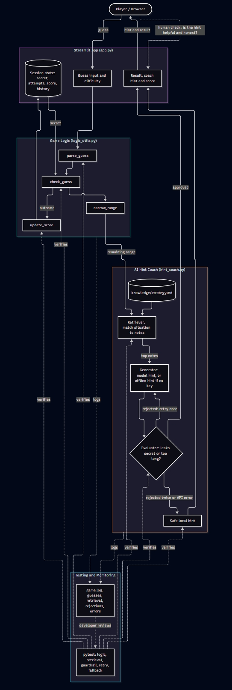

# 🎮 Game Glitch Investigator: AI Hint Coach

**Original project:** *Game Glitch Investigator: The Impossible Guesser* (Modules 1-3). It was a Streamlit number-guessing game that came with bugs on purpose: the hints were backwards, the secret number changed on every click, and the scoring was off. My job was to find the bugs, fix them, move the logic into `logic_utils.py`, and write `pytest` tests for it.

## Summary

For this project I added an **AI hint coach** to the fixed game. After each wrong guess it looks up strategy notes, uses them to write advice for the next guess, and checks that advice before showing it to the player. I picked this because the same pattern works well outside of games: give the AI real information to work from, check what it says, and have a plan for when it fails. The game still works when the AI isn't available.

## Architecture Overview

The diagram source is in [`diagrams/architecture.mmd`](diagrams/architecture.mmd) and the image is in [`assets/`](assets/architecture.jpeg).



Here is how a guess moves through the system:

1. **Input:** the player types a guess into the Streamlit app (`app.py`).
2. **Game logic** (`logic_utils.py`): the guess is parsed, checked against the secret and scored, and the range of numbers still possible gets narrower.
3. **Retriever** (`hint_coach.py`): the situation (last result, remaining range, attempts left) is turned into a query and matched against the notes in `knowledge/strategy.md`.
4. **Generator:** the best-matching notes and the current range go into a prompt for Claude. With no API key, the hint is built offline from the same notes.
5. **Evaluator / guardrail:** a model hint is rejected if it contains the secret, is too long or is empty. The coach tries once more, then uses a safe offline hint.
6. **Output:** the approved hint is shown with the result.
7. **Checks:** `pytest` covers the logic, retrieval, guardrail, retry and fallback. `game.log` records every guess, retrieval, rejection and error. The player is the human check on whether the hints actually help.

## Setup Instructions

```
git clone https://github.com/ugiagbeanthony/applied-ai-system-final.git
cd applied-ai-system-final
python -m venv .venv
.\.venv\Scripts\Activate.ps1        # macOS / Linux / Git Bash: source .venv/bin/activate
python -m pip install --upgrade pip
pip install -r requirements.txt
python -m streamlit run app.py
```

- **Optional model hints:** set `ANTHROPIC_API_KEY` before launching (PowerShell: `$env:ANTHROPIC_API_KEY="..."`). Without it the app runs fully offline. Override the model with `HINT_MODEL`.
- **Run tests:** `python -m pytest`
- **Logs:** written to `game.log` in the project folder.

## Sample Interactions

These are real outputs from the offline coach with the secret set to 37. Each row shows the plain baseline next to the coach style the app uses.

| Situation | Baseline (plain) | Specialized (coach) |
|-----------|------------------|---------------------|
| First turn, range 1-100 | The secret is between 1 and 100. Try 50. Tip: Always guess the midpoint of the range that is still possible. | Great start! Try 50: it splits 1-100 in half. |
| Guessed 50, Too High, range 1-49 | The secret is between 1 and 49. Try 25. Tip: When a guess is too high, the secret is lower. | Too high, but you're closing in! Try 25: it splits 1-49 in half. |
| Guessed 25, Too Low, range 26-49, 2 attempts left | The secret is between 26 and 49. Try 37. Tip: With one or two attempts left, pick the number that splits the remaining range most evenly... | Too low, keep climbing! Try 37: it splits 26-49 in half. |

The coach never gets the secret, so when a suggestion happens to match it (the last row), that's just the midpoint landing on it, not a leak. With an API key, the model writes the advice in its own words from the retrieved notes and the guardrail checks it.

**Coach style:** I limited the tone and format on purpose: 25 words or fewer, an encouraging opener, one number to try and a reason. With an API key the prompt teaches this using three examples (`FEW_SHOT` in `hint_coach.py`) plus style rules, and replies over 30 words get rejected. Offline, a template produces the same style. The comparison with the baseline is in the Testing Summary.

## Design Decisions

- **Retrieval instead of a plain prompt:** hints come from a small notes file, so the advice is based on something real and I can change it without touching code.
- **Simple keyword retrieval, not embeddings:** there are only seven short notes, so matching on shared words is simple, easy to test and needs no extra library. The downside is that it wouldn't hold up with a big collection of notes or ones worded differently.
- **Offline fallback:** anyone who clones the repo should be able to run it without a key or a network. The downside is that the offline hints sound more repetitive than the model's.
- **Guardrail after generation:** the prompt tells the model not to reveal the secret, but a prompt is only a request, so the code checks the reply too. The cost is an extra API call when a retry happens.
- **Logic separated from the UI:** `logic_utils.py` has no Streamlit imports, so I can test it directly.

## Testing Summary

**Automated tests:** 17 of 17 `pytest` tests pass (`python -m pytest`). They cover the game rules and the coach, including rejecting a leaking, wordy or empty model reply, recovering on a retry, and falling back when the model errors.

**Test harness:** `python evaluate.py` runs the system on a set of predefined inputs, prints three tables, and exits with an error if any case fails. It runs offline so the results are the same every time.

Predefined cases: **11/11 passed**, including injected model failures (leaking reply, wordy reply, API error, empty reply).

**Specialized style vs baseline** (72 situations, offline):

| Style | Avg words | Within 25 words | Encouraging opener | Names a number |
|-------|-----------|-----------------|--------------------|----------------|
| Baseline (plain) | 25.6 | 67% | 0% | 100% |
| Specialized (coach) | 11.0 | 100% | 100% | 100% |

These numbers only show that the coach follows the style rules I set. They don't show that players like it better. Building the harness also turned up two bugs: when one number was left the hint didn't say which to try, and an empty model reply would have shown up as a blank hint. Both are fixed and have tests.

**Full-game simulation** (follows the coach's suggested number):

**Reliability evaluation:** `python evaluate.py` plays every possible secret on every difficulty, always following the coach's suggested number, offline so it is reproducible.

| Difficulty | Attempts allowed | Games | Win rate | Avg guesses (wins) | Max guesses (wins) |
|------------|------------------|-------|----------|--------------------|--------------------|
| Easy | 6 | 20 | 100% | 3.70 | 5 |
| Normal | 8 | 100 | 100% | 5.80 | 7 |
| Hard | 5 | 50 | 62% | 4.16 | 5 |

**Logging and error handling:** `game.log` records every guess, retrieval query, rejected hint and API failure. If the model call fails, the error is caught and the game carries on with the offline hint.

**What I learned**
- If you follow the coach you win every Easy and Normal game, so the advice holds up. Hard is only 62% because five guesses can cover at most 31 of the 50 numbers, even with perfect play. That's a problem with the game's balance, not the coach, and I only saw it because I ran the evaluation.
- My first fix for the coach was wrong. I made the offline hint avoid suggesting the secret, and the evaluation showed that it broke the strategy and dropped Hard to 0%. I undid it, since the coach picks its number without knowing the secret and so isn't revealing anything.
- Not checked yet: I've only tested the real model call with mocks. I did load the Streamlit app and play a guess with Streamlit's AppTest, but that was a manual check, not part of the test suite.

## Execution Evidence

Everything below was produced by running the commands shown, offline with no API key. Full logs are in [`evidence/`](evidence/). Reproduce with the setup steps above.

**Example inputs and outputs** (`python -c` calling `get_hint`, with logging on; secret = 37):

```
INPUT : {'low': 1, 'high': 100, 'last_outcome': None, 'attempts_left': 8}
hint_coach INFO query='first guess binary search midpoint' retrieved=['binary search', 'first guess']
hint_coach INFO no API key set; using local hint
OUTPUT: ('Great start! Try 50: it splits 1-100 in half.', 'local')

INPUT : {'low': 1, 'high': 49, 'last_outcome': 'Too High', 'attempts_left': 7}
hint_coach INFO query='too high binary search midpoint' retrieved=['too high', 'binary search']
hint_coach INFO no API key set; using local hint
OUTPUT: ("Too high, but you're closing in! Try 25: it splits 1-49 in half.", 'local')
```

**Reliability and guardrail results** (`python evaluate.py`). The lines at the top are the guardrail's own log output as it rejected injected bad model replies:

```
hint rejected: leaked the secret
hint rejected: leaked the secret
hint rejected: too many words (62)
hint rejected: too many words (62)
model call failed: down
hint rejected: empty reply
hint rejected: empty reply
### Predefined cases

| Case | Result |
|------|--------|
| parse '42' | Pass |
| parse empty input | Pass |
| parse 'abc' | Pass |
| check_guess too high | Pass |
| check_guess too low | Pass |
| offline hint is the midpoint | Pass |
| clean model reply is used | Pass |
| model reply leaking secret is rejected | Pass |
| wordy model reply is rejected | Pass |
| model API error falls back | Pass |
| empty model reply falls back safely | Pass |

11/11 cases passed

### Style comparison (offline, 72 situations)

| Style | Avg words | Within 25 words | Encouraging opener | Names a number |
|-------|-----------|-----------------|--------------------|----------------|
| Baseline (plain) | 25.6 | 67% | 0% | 100% |
| Specialized (coach) | 11.0 | 100% | 100% | 100% |

### Full-game simulation (follows the coach's suggestion)

| Difficulty | Attempts allowed | Games | Win rate | Avg guesses (wins) | Max guesses (wins) |
|------------|------------------|-------|----------|--------------------|--------------------|
| Easy | 6 | 20 | 100% | 3.70 | 5 |
| Normal | 8 | 100 | 100% | 5.80 | 7 |
| Hard | 5 | 50 | 62% | 4.16 | 5 |
```

**Unit tests** (`python -m pytest -v`, last lines; full output in `evidence/pytest_output.txt`):

```
tests/test_game_logic.py::test_clean_model_output_is_used PASSED         [ 82%]
tests/test_game_logic.py::test_retry_recovers_after_leak PASSED          [ 88%]
tests/test_game_logic.py::test_model_error_falls_back PASSED             [ 94%]
tests/test_game_logic.py::test_empty_model_reply_falls_back PASSED       [100%]

============================= 17 passed in 0.07s ==============================
```

## Portfolio

- **Code:** https://github.com/ugiagbeanthony/applied-ai-system-final
- **Loom walkthrough (optional):** _link to be added_

**What this project says about me as an AI engineer:** I treat the model as one part of the system, not the whole thing. It needs real information to work from, its output needs to be checked, and the app needs to keep working when it fails. I'd rather build a small system I can measure than a bigger one I can only demo. In this project that meant notes the advice is based on, a guardrail and fallback so a bad reply never reaches the player, and an evaluation script that caught one of my own fixes making things worse.

## Reflection

The biggest thing I learned is that most of an AI feature is the work around the model: deciding what it sees, checking what it says, and deciding what happens when it fails. The model call itself is only a few lines. Retrieval, checks, logging and fallbacks took most of the effort. My responsible-AI reflection is in `model_card.md`.
